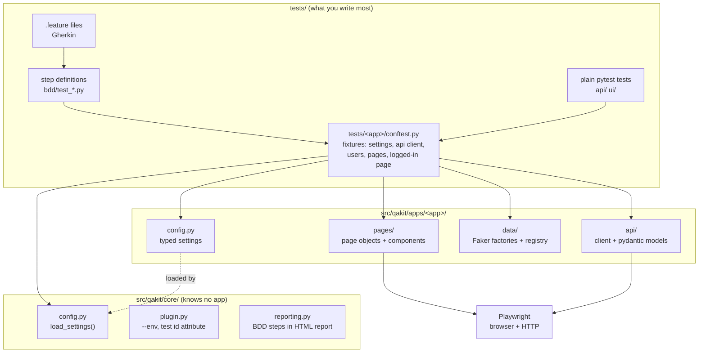
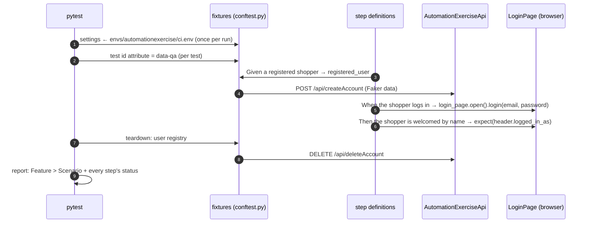

# 1. Architecture

## The big picture

qakit is **one installable package** (`pip install -e .`) with two halves:

- **`qakit.core`** knows no application. It holds the settings loader, the `--env` option,
  the test id mechanism and the reporting plugin. It is loaded automatically as a **pytest
  plugin** (a `pytest11` entry point in `pyproject.toml`).
- **`qakit.apps.<app>`**, one package per application under test. It holds that app's
  settings class, API client, page objects and test data factories.

The tests live outside the package, in `tests/<app>/`. Each app's `conftest.py` wires core
and app together into fixtures.

**Dependencies point one way:** tests → apps → core. `core` never imports from `apps`. You
can check that with a search: `grep -r "qakit.apps" src/qakit/core` must find nothing.

## Layers, top to bottom

| Layer | Lives in | Knows about | Example |
| --- | --- | --- | --- |
| Feature | `tests/<app>/bdd/features/*.feature` | business language only | `When the shopper logs in` |
| Step definition | `tests/<app>/bdd/test_*.py` | fixtures, page objects | `login_page.open().login(...)` |
| Plain test | `tests/<app>/api/`, `ui/` | fixtures, page objects, API client | `test_search_finds_matching_products` |
| Fixtures | `tests/<app>/conftest.py` | everything of one app + core | `registered_user`, `logged_in_page` |
| Page objects / API client / data | `src/qakit/apps/<app>/` | Playwright, the app's HTML and API | `ProductsPage.add_to_cart()` |
| Core | `src/qakit/core/` | pytest, Playwright, pytest-html, pytest-bdd | `load_settings()` |

## What happens when you run a BDD scenario

Take `Scenario: A registered shopper logs in` from
`tests/automationexercise/bdd/features/account.feature`:

Points to notice:

- The **step definitions contain no setup code**. "A registered shopper" is just the
  `registered_user` fixture: created through the API before the step, deleted after the test.
- The **browser is only started if a step asks for a page**. API-only tests never start one.
- **Teardown always runs**, even when a step fails, because cleanup lives after `yield` in a
  fixture.

## Fixture scopes used

| Fixture | Scope | Why |
| --- | --- | --- |
| `env_name`, `envs_root`, `settings` | session | `--env` can't change during a run |
| `api_request_context`, `ae_api` | session | one HTTP client, reused |
| `shopper`, `shopper_state` | session | log in through the UI once, reuse the cookies |
| `browser` (pytest-playwright) | session | starting a browser is slow |
| `context`, `page`, page objects | function | every test gets a clean browser context |
| `user_factory`, `registered_user`, `new_user` | function | each test owns its users and cleans them up |

A fixture can only use fixtures with the **same or a wider** scope. A session fixture asking
for a function fixture fails with `ScopeMismatch`.

## Why this layout?

See [ADR 0001](../adr/0001-core-and-apps-layout.md). In short:

- Adding an app is **additive**: new `apps/<app>/`, `envs/<app>/`, `tests/<app>/`, and nothing
  else changes. saucedemo was added this way.
- Code moves into `core` only when a **second app needs it**. The test id attribute mechanism
  went into `core` because both apps needed it. Ad blocking stayed in automationexercise,
  because only that site shows ads.
