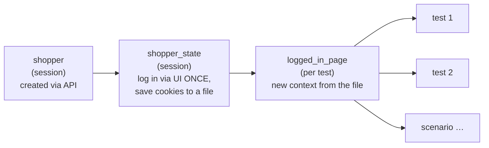

# 6. Test data and hybrid tests

## Factories: realistic data, override only what matters

```python
from qakit.apps.automationexercise.data.users import build_user

build_user(faker)                          # a full random NewUser (17 fields)
build_user(faker, country="Canada")        # random, except the field the test is about
```

- `faker` is a fixture from Faker's pytest plugin. It is **reseeded to 0 for every test**,
  so the data is the same on every run, and a failure reproduces with the same name and
  address.
- **Emails are uuids, not Faker.** With a fixed seed, `faker.email()` would return the same
  address in every run, and the demo site is shared with everyone who practises on it.
- Keyword arguments replace fields. `replace()` rejects a typo like `frist_name=` with a
  `TypeError`. (Java: `UserBuilder.aUser().withCountry("Canada").build()`.)

## Users that clean up after themselves

| Fixture | Gives you | Deleted after the test |
| --- | --- | --- |
| `registered_user` | a user that **exists** (created through the API) | ✅ |
| `new_user` | a user that does **not exist yet** (for signup tests) | ✅ if the test created it |
| `user_factory` | `user_factory.create(**overrides)` for several users | ✅ all of them |

They are all built on `UserRegistry` (`data/registry.py`):

```python
with UserRegistry(ae_api, faker) as users:   # Java: try-with-resources on an AutoCloseable
    a = users.create()
    b = users.create(country="India")
# here every user is deleted through the API, even if the block raised
```

The registry deletes newest-first, treats "already deleted" (404) as fine, and keeps going
when one delete fails, then reports all failures together.
`test_registry_deletes_every_user_it_created` proves it leaves nothing behind.

## Hybrid tests: API for setup, UI for the test

Signing up through the UI takes ~15 form fields and several seconds. Unless the signup form
*is* what you're testing, create the user through the API:

```python
def test_login_with_valid_credentials(login_page: LoginPage, registered_user: NewUser) -> None:
    login_page.open().login(registered_user.email, registered_user.password)
    expect(login_page.header.logged_in_as).to_contain_text(registered_user.name)
```

Checking through the API works too. The signup scenario's last step asks
`ae_api.user_detail(email)` whether the account really exists, which is an independent
source next to "Account Created!" on screen.

## Skipping the login form: storage state



`logged_in_page` starts **already logged in**. The login form ran once for the whole run.

⚠️ Every test using `logged_in_page` shares **one server session**:

- **Never log out or delete the account** with it. That would end the session for every
  later test. Tests about logout use `registered_user` + the login form.
- The **cart is shared** too, so assert "the cart contains X", not "the cart is exactly [X]".

## Choosing a fixture

| You are testing… | Use |
| --- | --- |
| the signup form | `new_user` + `login_page` + `signup_page` |
| login / logout / wrong password | `registered_user` + `login_page` |
| something that needs a logged-in user | `logged_in_page` |
| something a guest can do | `page` / page object fixtures |
| an API endpoint | `ae_api` (+ `registered_user` if it needs an account) |
