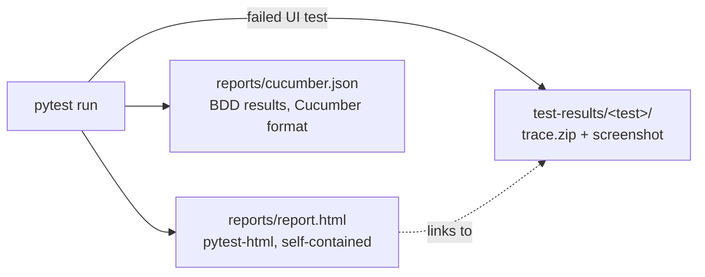
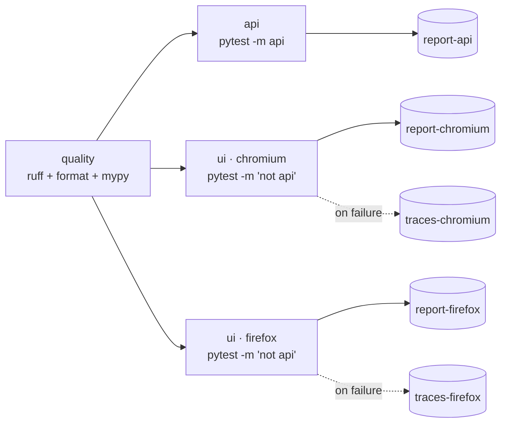

# 7. Reports, traces and CI

## What every run produces



All of it comes from `addopts` in `pyproject.toml`, so a plain `pytest` produces it:

```toml
addopts = """
    --html=reports/report.html --self-contained-html
    --cucumberjson=reports/cucumber.json
    --tracing=retain-on-failure --screenshot=only-on-failure --output=test-results
"""
```

## Reading the HTML report

Open `reports/report.html` in any browser. No server or extra tool is needed.

| Part | What it shows | Added by |
| --- | --- | --- |
| Title "qakit test report" | | `core/reporting.py` |
| **Environment** table | Python, platform, plugins, **Environment (--env)** | pytest-metadata + `core/reporting.py` |
| Summary + filters | passed / failed / skipped / errors; click to filter | pytest-html |
| **Description** column | BDD: `Feature > Scenario`; plain tests: the docstring's first line | `core/reporting.py` |
| Expanded row, BDD | every Gherkin step: **passed** / **failed** (with the error) / **not run** | `core/reporting.py` |
| Expanded row, failed UI test | the **screenshot** at the moment of failure and a **Trace** link | pytest-playwright |
| Expanded row, any failure | the traceback and captured output | pytest |

Write a one-line docstring for every plain test, because it becomes the Description:

```python
def test_search_without_match_returns_empty_list(ae_api: AutomationExerciseApi) -> None:
    """No match is still responseCode 200, with an empty list."""
```

## Replaying a failure with the trace

A trace is a full recording: every action, DOM snapshots before/after, network calls,
console logs.

```powershell
playwright show-trace test-results\<test-folder>\trace.zip
```

You can also drop the zip on https://trace.playwright.dev (it runs locally in your browser).
To keep traces for passing tests too: `pytest --tracing on`.

## Cucumber JSON

`reports/cucumber.json` follows the Cucumber JSON format, so the tools you know from
Cucumber-JVM read it:

- **Jira Xray / Zephyr**: import the execution results.
- **cucumber-html-reporter / multiple-cucumber-html-reporter** (npm): a Cucumber-style HTML report.
- **Jenkins Cucumber Reports plugin**: trend charts per feature.

## CI: GitHub Actions

`.github/workflows/ci.yml` runs on every push to `main`, every pull request, and on demand
("Run workflow").



- **quality** fails fast, before any browser starts.
- **api** runs once: the API doesn't depend on the browser.
- **ui** runs once per browser in the matrix. `fail-fast: false` lets every browser finish.
- **Reports are uploaded on every run** (`if: always()`). **Traces only on failure**, kept 7 days.

To download them: Actions tab → the run → **Artifacts** at the bottom → unzip → open
`report.html` or `playwright show-trace trace.zip`.

### Secrets in CI

Real environment variables override the `.env` files. For a real application, keep
passwords out of `envs/` and add them as repository secrets:

```yaml
      - run: pytest --env ci
        env:
          SD_PASSWORD: ${{ secrets.SD_PASSWORD }}
```

The saucedemo password sits in `envs/saucedemo/*.env` only because saucedemo prints it on its
own login page. It's typed `SecretStr`, so it shows as `**********` in logs anyway.
